# Diagramas de Atividades

Convertidos do board Miro "Meu primeiro board" (grupo "Diagrama de atividades", 13 frames). As raias (swimlanes) do board viraram `subgraph`; o início é `((Início))`, o fim é `(((Fim)))` e as decisões são losangos.

1. [Cadastrar Estudante](#1-cadastrar-estudante)
2. [Realizar Login](#2-realizar-login)
3. [Esqueci Minha Senha](#3-esqueci-minha-senha)
4. [Realizar Teste Vocacional](#4-realizar-teste-vocacional)
5. [Visualizar Resultado do Teste Vocacional](#5-visualizar-resultado-do-teste-vocacional)
6. [Favoritar Curso](#6-favoritar-curso)
7. [Favoritar Universidade](#7-favoritar-universidade)
8. [Assinatura](#8-assinatura)
9. [Realizar Pagamento](#9-realizar-pagamento)
10. [Emitir Nota Fiscal](#10-emitir-nota-fiscal)
11. [Alterar Plano de Assinatura](#11-alterar-plano-de-assinatura)
12. [Cancelar Assinatura](#12-cancelar-assinatura)
13. [Simulado](#13-simulado)

---

## 1. Cadastrar Estudante

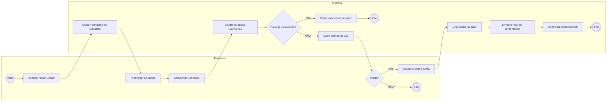

---

## 2. Realizar Login

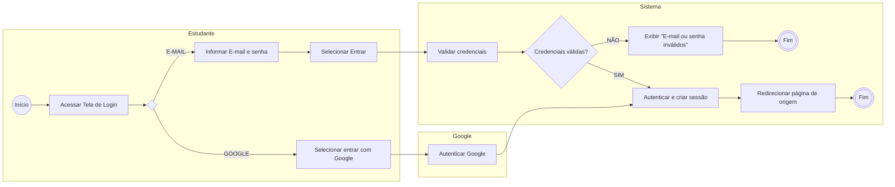

---

## 3. Esqueci Minha Senha

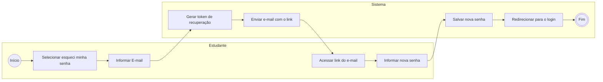

---

## 4. Realizar Teste Vocacional

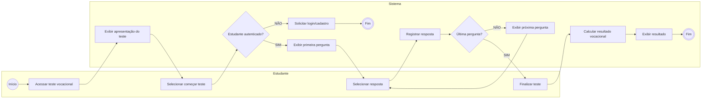

---

## 5. Visualizar Resultado do Teste Vocacional

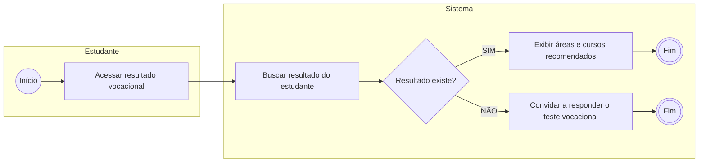

---

## 6. Favoritar Curso

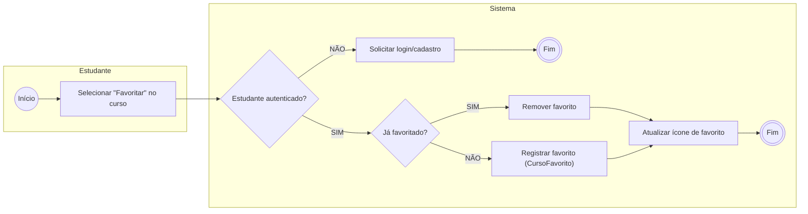

---

## 7. Favoritar Universidade

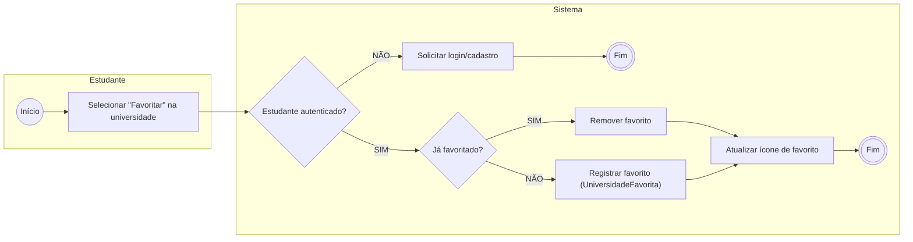

---

## 8. Assinatura

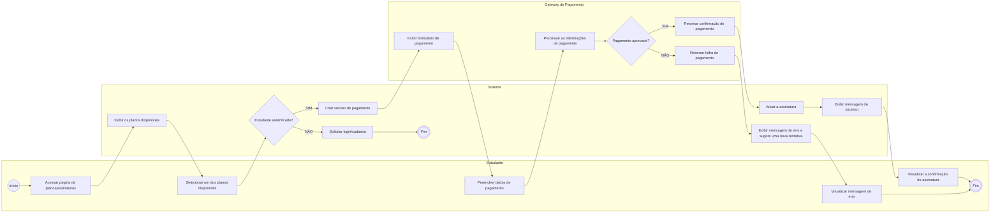

---

## 9. Realizar Pagamento

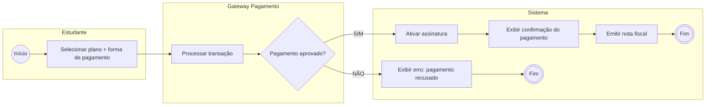

---

## 10. Emitir Nota Fiscal

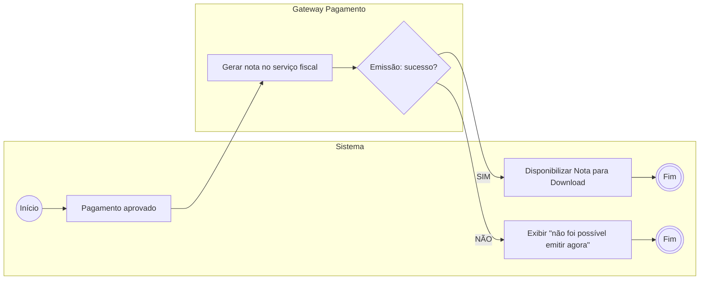

---

## 11. Alterar Plano de Assinatura

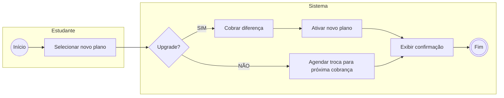

---

## 12. Cancelar Assinatura

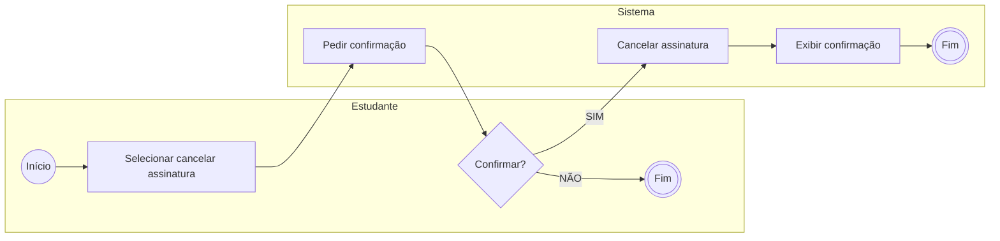

---

## 13. Simulado

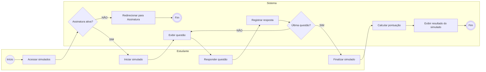
