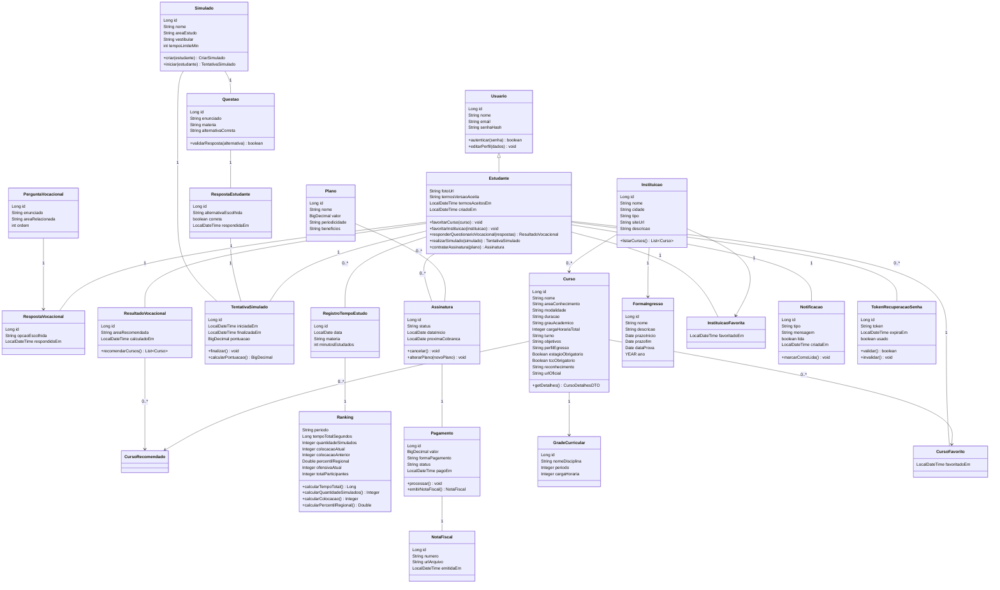

# Diagramas UML

Convertidos do board Miro "Meu primeiro board" (frames "Diagrama de Casos de Uso", "Diagrama de Classe" e "Diagrama de Entidade e Relacionamentos").

---

## 1. Diagrama de Casos de Uso

Mermaid não tem diagrama de casos de uso nativo, então foi usado `flowchart`: atores em retângulo, casos de uso em elipse e relações `«include»` / `«extend»` em linha tracejada (a seta aponta do caso que inclui/estende para o caso base, como no board). Casos de uso sem nenhuma ligação no board aparecem soltos no fim.

```mermaid
flowchart LR
    Visitante["👤 Visitante"]
    Estudante["👤 Estudante"]

    subgraph Sistema["Sistema"]
        direction TB

        subgraph Conta["Conta e acesso"]
            RealizarCadastro(["Realizar cadastro"])
            AceitarTermos(["Aceitar termos de uso"])
            RealizarLogin(["Realizar login"])
            EsqueciSenha(["Esqueci minha senha"])
            LoginGoogle(["Realizar login pelo Google"])
            RedefinirSenha(["Redefinir senha"])
            RealizarLogout(["Realizar logout"])
            TelaInicial(["Visualizar tela inicial"])
            VisualizarPerfil(["Visualizar perfil do estudante"])
            EditarPerfil(["Editar perfil"])
            Notificacoes(["Visualizar notificações"])
        end

        subgraph Assinatura["Assinatura e pagamento"]
            RealizarAssinatura(["Realizar assinatura"])
            EscolherPlano(["Escolher plano de assinatura"])
            VisualizarAssinatura(["Visualizar assinatura"])
            AlterarPlano(["Alterar plano de assinatura"])
            CancelarAssinatura(["Cancelar assinatura"])
            FormasPagamento(["Visualizar formas de pagamento"])
            RealizarPagamento(["Realizar pagamento"])
            EmitirNota(["Emitir nota fiscal"])
        end

        subgraph Catalogo["Instituições e cursos"]
            VisualizarInstituicoes(["Visualizar instituições"])
            PesquisarInstituicoes(["Pesquisar instituições"])
            FiltrarInstituicoes(["Filtrar instituições"])
            DetalhesInstituicao(["Visualizar detalhes da instituição"])
            SiteIES(["Redirecionar para site da IES"])
            VisualizarCursos(["Visualizar cursos"])
            PesquisarCursos(["Pesquisar cursos"])
            FiltrarCursos(["Filtrar cursos"])
            DetalhesCurso(["Visualizar detalhes do curso"])
            PaginaCursoIES(["Redirecionar para página do curso na IES"])
            FavoritarCurso(["Favoritar curso"])
            FavoritarIES(["Favoritar IES"])
            CursosFavoritados(["Visualizar cursos favoritados"])
            IESFavoritados(["Visualizar IES favoritados"])
            Calendario(["Visualizar calendário acadêmico"])
            FormasIngresso(["Visualizar formas de ingresso"])
        end

        subgraph Vocacional["Teste vocacional"]
            ResponderQuestionario(["Responder questionário vocacional"])
            ResultadoVocacional(["Visualizar resultado vocacional"])
            RefazerTeste(["Refazer teste vocacional"])
        end

        subgraph Simulados["Simulados e acompanhamento"]
            RealizarSimulado(["Realizar simulado"])
            RefazerSimulado(["Refazer simulado"])
            FiltrarVestibular(["Filtrar simulado por vestibular"])
            FiltrarArea(["Filtrar simulado por área de estudo"])
            ResultadoSimulado(["Visualizar resultado do simulado"])
            Historico(["Visualizar histórico de questões"])
            FiltrarHistorico(["Filtrar histórico de questões"])
            Ranking(["Visualizar ranking"])
            FiltrarRanking(["Filtrar ranking por período"])
            TempoEstudo(["Visualizar tempo de estudo"])
            FiltrarTempo(["Filtrar tempo de estudo"])
            Acompanhamento(["Visualizar meu acompanhamento"])
            FiltrarAcompanhamento(["Filtrar acompanhamento por período"])
            SequenciaRespostas(["Visualizar sequência de respostas"])
        end
    end

    %% Associações do ator Visitante
    Visitante --- RealizarCadastro
    Visitante --- TelaInicial
    Visitante --- VisualizarInstituicoes
    Visitante --- VisualizarCursos
    Visitante --- Calendario
    Visitante --- FormasIngresso

    %% Associações do ator Estudante
    Estudante --- RealizarPagamento
    Estudante --- FormasPagamento
    Estudante --- ResponderQuestionario
    Estudante --- Notificacoes
    Estudante --- AlterarPlano
    Estudante --- VisualizarAssinatura
    Estudante --- TelaInicial
    Estudante --- RealizarAssinatura
    Estudante --- VisualizarInstituicoes
    Estudante --- CancelarAssinatura
    Estudante --- RealizarSimulado
    Estudante --- Historico
    Estudante --- TempoEstudo
    Estudante --- Ranking
    Estudante --- SequenciaRespostas
    Estudante --- RedefinirSenha

    %% Conta
    RealizarCadastro -.->|«include»| AceitarTermos
    EsqueciSenha -.->|«extend»| RealizarLogin
    LoginGoogle -.->|«extend»| RealizarLogin

    %% Assinatura e pagamento
    RealizarAssinatura -.->|«include»| EscolherPlano
    RealizarPagamento -.->|«include»| EmitirNota

    %% Instituições e cursos
    DetalhesInstituicao -.->|«extend»| PesquisarInstituicoes
    DetalhesInstituicao -.->|«extend»| VisualizarInstituicoes
    SiteIES -.->|«extend»| DetalhesInstituicao
    DetalhesCurso -.->|«extend»| VisualizarCursos
    DetalhesCurso -.->|«extend»| PesquisarCursos
    PesquisarCursos -.->|«extend»| VisualizarCursos
    FiltrarCursos -.->|«extend»| VisualizarCursos

    %% Teste vocacional
    ResponderQuestionario -.->|«include»| ResultadoVocacional
    RefazerTeste -.->|«extend»| ResultadoVocacional

    %% Simulados e acompanhamento
    RealizarSimulado -.->|«include»| ResultadoSimulado
    FiltrarVestibular -.->|«extend»| RealizarSimulado
    FiltrarArea -.->|«extend»| RealizarSimulado
    RefazerSimulado -.->|«extend»| RealizarSimulado
    FiltrarHistorico -.->|«extend»| Historico
    FiltrarTempo -.->|«extend»| TempoEstudo
    FiltrarRanking -.->|«extend»| Ranking
    FiltrarAcompanhamento -.->|«extend»| Acompanhamento

    %% Casos de uso sem ligação no board
    RealizarLogout ~~~ VisualizarPerfil
    EditarPerfil ~~~ FiltrarInstituicoes
    PaginaCursoIES ~~~ FavoritarCurso
    FavoritarIES ~~~ CursosFavoritados
    IESFavoritados ~~~ FormasIngresso
```

---

## 2. Diagrama de Classes

Cores do board agrupavam as classes por área; aqui estão só os nomes, atributos e operações. Os rótulos nas linhas (`1`, `0..*`) são os que estavam nos conectores do board. Setas (`-->`) indicam os conectores com ponta no board. A ligação sem rótulo entre `Usuario` e `Estudante` foi interpretada como generalização.

---

## 3. Diagrama de Entidade e Relacionamentos

As cardinalidades do Mermaid foram deduzidas das chaves estrangeiras e dos rótulos dos conectores do board (`1`, `N`, `0..1`). Os nomes dos relacionamentos são os do board quando existiam (`Contrata`, `Gera`, `Pertence`, `contém`, `é tentado em`, `Notícia sobre`); nos demais foi usado "possui".

```mermaid
erDiagram
    Estudante ||--o{ ResultadoVocacional : possui
    Estudante ||--o{ RankingEstudante : possui
    Estudante ||--o{ RespostaQuestionarioVocacional : possui
    Estudante ||--o{ CursoFavorito : possui
    Estudante ||--o{ InstituicaoFavorita : possui
    Estudante ||--o{ Notificacao : possui
    Estudante ||--o{ TokenRecuperacaoSenha : possui
    Estudante ||--o{ TentativaSimulado : possui
    Estudante ||--o{ Assinatura : Contrata
    Estudante ||--o{ RegistroTempoEstudo : possui

    PerguntaVocacional ||--o{ RespostaQuestionarioVocacional : possui
    RespostaQuestionarioVocacional }o--|| ResultadoVocacional : Gera
    ResultadoVocacional ||--o{ CursoRecomendado : possui
    Curso ||--o{ CursoRecomendado : possui

    RegistroTempoEstudo }o--|| RankingEstudante : Gera

    Simulado ||--o{ TentativaSimulado : "é tentado em"
    Simulado ||--o{ Questao : contém
    TentativaSimulado ||--o{ RespostaEstudante : possui
    Questao ||--o{ RespostaEstudante : possui

    Plano ||--o{ Assinatura : possui
    Assinatura ||--o{ Pagamento : possui
    Pagamento ||--o| NotaFiscal : possui
    Notificacao }o--|| Assinatura : "Notícia sobre"
    Notificacao }o--|| FormaIngresso : "Notícia sobre"

    Instituicao ||--o{ Curso : possui
    Instituicao ||--o{ InstituicaoFavorita : possui
    Instituicao ||--o{ FormaIngresso : possui
    Curso ||--o{ CursoFavorito : possui
    Curso ||--o{ GradeCurricular : Pertence

    Estudante {
        int id_estudante PK
        string nome
        string email
        string senha_hash
        string foto_url
        string termos_versao_aceita
        datetime termos_aceitos_em
        datetime criado_em
        int nota_enem
    }

    ResultadoVocacional {
        long id_resultado PK
        long id_estudante FK
        string area_recomendada
        datetime calculado_em
    }

    CursoRecomendado {
        long id_resultado FK
        long id_curso FK
    }

    PerguntaVocacional {
        long id_pergunta PK
        text enunciado
        string area_relacionada
        int ordem
    }

    RespostaQuestionarioVocacional {
        long id_resposta_vocacional PK
        long id_estudante FK
        long id_pergunta FK
        datetime respondido_em
    }

    RankingEstudante {
        int id_ranking PK
        int id_estudante FK
        string periodo
        string criterio
        int tempo_total_segundos
        int quantidade_simulados
        int total_participantes
        int colocacao_atual
        int colocacao_anterior
        decimal percentil_regional
        int ofensiva_atual
        datetime data_calculo
    }

    RegistroTempoEstudo {
        long id_registro PK
        long id_estudante FK
        date data
        string materia
        long minutos_estudados
    }

    CursoFavorito {
        long id_estudante FK
        long id_curso FK
        datetime favoritado_em
    }

    InstituicaoFavorita {
        long id_estudante FK
        long id_instituicao FK
        datetime favoritado_em
    }

    Notificacao {
        long id_notificacao PK
        long id_estudante FK
        string tipo
        string mensagem
        boolean lida
        datetime criada_em
    }

    TokenRecuperacaoSenha {
        long id_token PK
        long id_estudante FK
        string token
        datetime expira_em
        boolean usado
    }

    Simulado {
        int id_simulado PK
        string nome
        string area_estudo
        string vestibular
        int tempo_limite_min
    }

    Questao {
        int id_questao PK
        int id_simulado FK
        text enunciado
        string materia
        string alternativa_correta
    }

    TentativaSimulado {
        long id_tentativa PK
        long id_estudante FK
        int id_simulado FK
        datetime iniciada_em
        datetime finalizada_em
        decimal pontuacao
    }

    RespostaEstudante {
        int id_resposta PK
        int id_tentativa FK
        int id_questao FK
        string alternativa_escolhida
        boolean correta
        datetime respondida_em
    }

    Plano {
        int id_plano PK
        string nome
        double valor
        string periodicidade
        text beneficios
    }

    Assinatura {
        long id_assinatura PK
        long id_estudante FK
        long id_plano FK
        date data_inicio
        date data_fim
        date proxima_cobranca
    }

    Pagamento {
        long id_pagamento PK
        long id_assinatura FK
        long id_cupom FK
        decimal valor
        string forma_pagamento
        string status
        datetime pago_em
    }

    NotaFiscal {
        long id_nota_fiscal PK
        long id_pagamento FK
        string numero
        string url_arquivo
        datetime emitida_em
    }

    Instituicao {
        int id_instituicao PK
        string nome
        string cidade
        string tipo
        string site_url
        text descricao
    }

    Curso {
        int id_curso PK
        int id_instituicao FK
        string nome
        string area_conhecimento
        string grau_academico
        string modalidade
        string turno
        text descricao
        text objetivos
        boolean estagio_obrigatorio
        boolean tcc_obrigatorio
        string reconhecimento
        text url_oficial
        string duracao
    }

    GradeCurricular {
        int id_grade_curricular PK
        int id_curso FK
        string nome_disciplina
        int periodo
        int carga_horaria
    }

    FormaIngresso {
        long id_forma_ingresso PK
        int id_instituicao FK
        string nome
        text descricao
        date prazo_inicio
        date prazo_fim
        date data_prova
        int ano
        decimal nota_corte
    }
```

---

## Observações sobre o board

- **Casos de uso soltos:** vários casos de uso (logout, perfil, editar perfil, filtrar instituições, favoritar/listar favoritos, redirecionar para a página do curso na IES) não têm nenhuma ligação no board, e "visualizar meu acompanhamento" só tem o `«extend»` do filtro, sem ator. Mantive como estão.
- **Excluídos:** as classes `SequenciaEstudante` e `CalendarioAcademico`, e a entidade `CalendarioAcademico`, estão numa caixa tracejada "Escluidos" no board e ficaram de fora.
- **ER, ligação sem FK:** o board liga `Estudante` a `PerguntaVocacional` (rótulo `1`), mas não existe chave estrangeira correspondente, então não incluí essa linha. `Notificacao` → `Assinatura` e `Notificacao` → `FormaIngresso` ("Notícia sobre") também não têm FK; mantive as linhas, com cardinalidade deduzida.
- **ER, `id_cupom`:** `Pagamento` tem FK `id_cupom`, mas não há entidade `Cupom` no board.
- **Typos corrigidos no ER:** `id_questa` → `id_questao`, `id_forma_ingersso` → `id_forma_ingresso`, `datatime` → `datetime`.
